# Shot campaigns: analysis and conclusions

Experiments run in grSim on 20–21/10/2026 with `./ararabots.sh campanha` (scripts
`campanha_chute.py`, `campanha_graficos.py`, `analise_campanhas.py`). Figures for
the comparisons are in `analise-campanhas/`; each experiment folder also has its own
plots in `<folder>/graficos/` and a `resumo.md`.

---

## 1. Conclusions

1. **The carrier is accurate when it kicks.** Without a keeper, 95.6% of 500 random
   placements end in a goal. The shot leaves exactly where the body points, with a
   median miss of 50 mm on the goal line. Distance hardly matters; steep angles (more
   than 50° off the goal's axis) do.
2. **The refactor changed nothing measurable.** The new role structure scored 99 of
   100 on the same placements where the old code scored 97, inside the noise. The
   offline recorder had already shown identical output.
3. **The real weakness is the first touch.** In **16% of attempts the robot's first
   contact with the ball is a push, not a kick** (63 of 399). The kick is armed in 57
   of 63 of them; the ball simply meets the front of the robot 63 mm (median) from the
   centre of the kicker, and grSim only fires within 40 mm. A push costs about 3.5 s
   (median time to kick 6.3 s instead of 2.7 s), and **every no-kick attempt started
   with one** (8 of 8). Next to their area or a touch line the pushed ball is lost: that is
   the "no kick in front of their goal" problem.
4. **None of the three fixes tried for item 2 changed the goal rate near their goal**
   (55, 54, 47/50 and 54 of 60). With 60 attempts per arm a difference of a few
   points cannot be seen. Future fixes for the approach should be judged on the
   *push rate at the first touch* (16%), which is far more sensitive.
5. **A static keeper costs 3–4.5 points.** On the same 200 placements: 194 goals
   without a keeper, 185 with it on the goal line (6 saved), 188 with it anywhere in
   the area (4 stopped). The strategy shoots to the side away from the keeper, and lands
   a median 40–48 mm from its own aim.
6. **Saves are mostly shots into narrow gaps.** In 4 of the 6 saves the open gap was
   only 2–5° wide and the shot landed 280–470 mm from its aim, towards the keeper. The
   fixed 20° kick gate is much wider than such a gap. The other 2 were simply bad
   kicks.
7. **Two problems in the movement and referee chain were found and fixed** along the
   way (section 9): the penalty-area obstacle was 180 mm too narrow, and in
   simulation our referee node accepted another machine's game controller.

8. **Steps 1–3 were done and measured (section 10).** The line-up rule cut the slow
   attempts (p90 time to kick 5.8 → 4.0 s) and the no-kicks (5 → 2); the gap gate cut
   kicks fired outside the gap (16 → 6 of about 197). Pushes fell from 17% to 12%.
   None of it changed the goal rate (185 → 187 of 200), and pushes remain the main
   weakness: the robot still drifts sideways in the last few hundred millimetres.

### Recommended next steps, in order

| # | what | status / how to measure |
|---|---|---|
| 1 | Make the robot arrive **square to the ball** | done (section 10): pushes 17% → 12%, slow attempts and no-kicks down; not enough |
| 2 | **Kick gate from the target gap** | done (section 10): kicks outside the gap 16 → 6; saves unchanged |
| 3 | Why about 1 shot in 10 leaves nearer the goal centre than the gap | answered (section 6.3): kicks fired 4–10° off the aim; addressed by 2 |
| 4 | Where the **sideways drift during the push** comes from | found (section 10.1): the plan ends ±50 mm around the compensated line, wider than the kicker's ±40 mm; moving the target made it worse |
| 4a | Precision of the movement chain in the last 300 mm (planner, tracker, controller), measured with `gravar_referencia.py` | spread of the reference and of the robot at contact; push rate |
| 4b | Settle before pushing: on the line and nearly still sideways | push rate and time to kick |
| 5 | Retune the predicted-turn gate with a shorter look-ahead (Sumatra uses 10–47 ms) | saves and push rate together |
| 6 | A **moving** keeper, then defenders (`--inimigos`) | the same campaigns |

---

## 2. How the experiments were run

* **Attempt:** the ball and our carrier (blue robot 1) are teleported to a random
  placement; the carrier gets `FORCE_START` and has 20 s. Placement of attempt *i*
  depends only on the seed and *i*, so **runs on the same seed are paired attempt by
  attempt**.
* **Default placement:** ball anywhere with x in [-1500, 3400] (we attack +x), robot
  300–2500 mm from it at a random bearing and heading.
* **Aim:** forced to one of y = -350, -175, 0, 175, 350 inside the goal, or, in the
  keeper experiments, chosen by the strategy itself (`--miras auto`).
* **Keeper:** a static yellow robot, on the goal line anywhere across the mouth
  (`--goleiro gol`) or anywhere inside their penalty area (`--goleiro area`).
* **Measurement** comes from grSim's own detection frames, not from our tracker. A
  kick is a take-off above 1500 mm/s with the kicker armed; a faster ball without the
  kicker armed is counted as a bump.
* **Outcomes:** `gol`, `defendido` (passed within 200 mm of the keeper and stopped),
  `fora` (wide or out of the field), `curto` (kicked and died in the field),
  `sem_chute` (never kicked).
* Intervals are 95% Wilson intervals.

**Caveats.** This is grSim with perfect vision and ideal physics, no opponents except
one robot that does not move. It measures the carrier's mechanics, not game
performance.

### The experiments

| folder | what | placements | attempts |
|---|---|---|---|
| `campanha_antes/` | baseline, code before the refactor, forced aims | seed 1, whole field | 500 |
| `campanha/` | after the refactor | seed 1 (first 100) | 100 |
| `area_sem_recorte/` | near their goal, before the fixes for item 2 (planner area fix only) | seed 7, x 2500–3400, \|y\| ≤ 1500 | 60 |
| `area_com_recorte/` | + push target clipped at the area edge | seed 7, same | 60 |
| `area_na_linha/` | + push target on the line of fire (stopped at 50 by a network change; variant dropped) | seed 7, same | 50 |
| `area_centro/` | + push aimed through the ball's centre (variant dropped) | seed 7, same | 60 |
| `campo_centro/` | push through the centre, whole field | seed 1 (first 100) | 100 |
| `goleiro_linha/` | static keeper on the goal line, strategy's own aim | seed 1 (first 200) | 200 |
| `goleiro_area/` | static keeper anywhere in their area, strategy's own aim | seed 1 (first 200) | 200 |

### All results

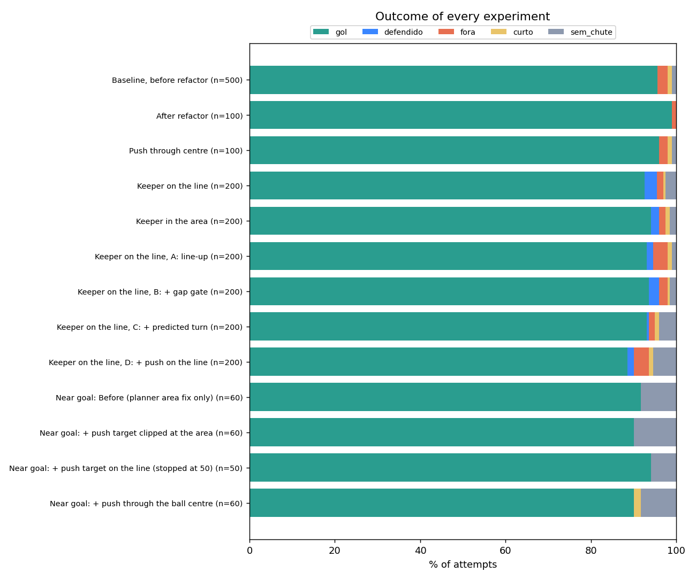

| experiment | attempts | goals (95% CI) | saved | wide | short | no kick | time to kick, median / p90 (s) | ball pushed >300 mm before the kick |
|---|---|---|---|---|---|---|---|---|
| Baseline, before refactor | 500 | **95.6%** (93–97) | 0 | 12 | 5 | 5 | 2.7 / 3.8 | 28 |
| After refactor | 100 | **99.0%** (95–100) | 0 | 1 | 0 | 0 | 2.8 / 3.7 | 6 |
| Push through centre | 100 | **96.0%** (90–98) | 0 | 2 | 1 | 1 | 2.8 / 4.1 | 8 |
| Keeper on the line | 200 | **92.5%** (88–95) | 6 | 3 | 1 | 5 | 2.9 / 5.6 | 25 |
| Keeper in the area | 200 | **94.0%** (90–97) | 4 | 3 | 2 | 3 | 2.8 / 4.2 | 19 |
| Near goal: before | 60 | **91.7%** (82–96) | 0 | 0 | 0 | 5 | 2.5 / 5.3 | 6 |
| Near goal: + clipped at the area | 60 | **90.0%** (80–95) | 0 | 0 | 0 | 6 | 2.6 / 3.6 | 4 |
| Near goal: + on the line (50) | 50 | **94.0%** (84–98) | 0 | 0 | 0 | 3 | 2.5 / 3.4 | 1 |
| Near goal: + through the centre | 60 | **90.0%** (80–95) | 0 | 0 | 1 | 5 | 2.6 / 5.9 | 9 |

---

## 3. Baseline: how good is the carrier without a keeper

500 attempts, `campanha_antes/`. Its full set of plots is in
`campanha_antes/graficos/`; the most informative ones are below.

**Distance barely matters.** Goals per shot stay between 95% and 100% from under
1.5 m to beyond 6 m.

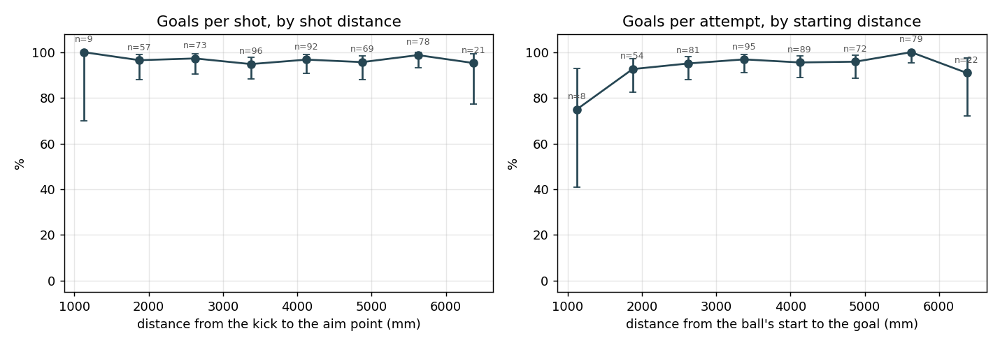

**Angle does.** About 95–100% up to 45° off the goal's axis, then 83% at 50–60° and
57% at 60–70° (7 attempts). The miss in millimetres hardly grows; the goal mouth
seen from the side shrinks.

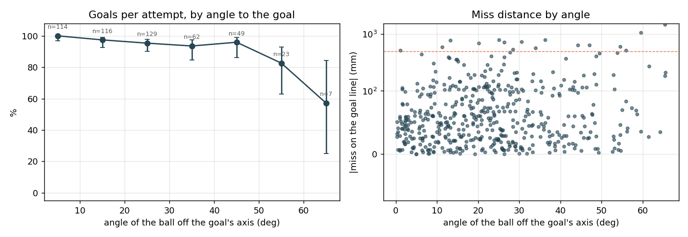

**Where on the field.** Green almost everywhere; the weak cells are right in front of
their area and the corners near their goal.

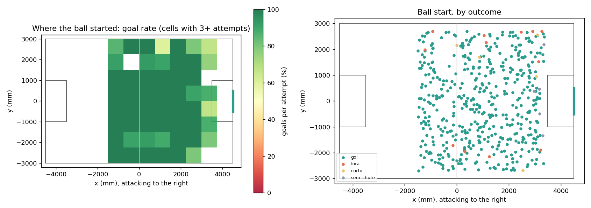

**The aim point inside the goal costs little.** The middle half of the shots lands
within about ±50 mm of the aim. Aiming at ±350 mm costs 3–4 points against the
centre, all from a few large misses, not from spread.

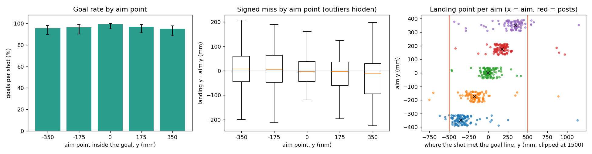

**The miss is the body's aim.** The shot direction error equals the body error at the
kick (the dots lie on the diagonal): contact and kicker physics add nothing. Every
wide shot had a body error of 7–18°, all inside the 20° kick gate; beyond about 1.5 m
that gate is wider than half the goal (right panel).

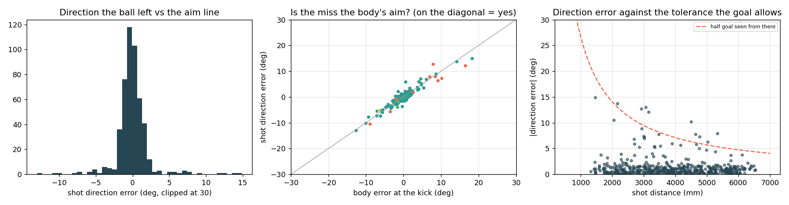

**The approach.** A kick usually takes 1.5–3.5 s, more the further the robot has to
circle the ball. About 5% of attempts take 5–9 s; section 5 shows why.

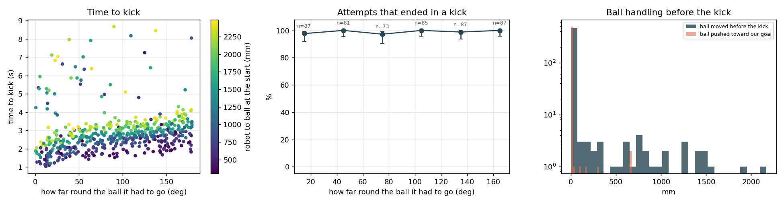

---

## 4. Near their goal: three fixes, no change

The baseline's no-kicks were all with the ball just outside their penalty area. The
replays showed the robot touching the ball without the kick firing, pushing it into
the area, where our robots are not allowed, and then circling the edge until the time
ran out. Three fixes were tried, each on the same 60 placements near their goal:

1. **Clip the push target at the area's edge**, along the line of fire (the planner
   moved targets inside the area to its nearest edge, off the line). Kept: harmless,
   and correct.
2. **Keep the push target on the line of fire** (its fixed −27 mm sideways offset
   turned the target by up to 30° in the last 250 mm). Dropped.
3. **Aim the push through the ball's centre** from wherever the robot is. Dropped: it
   also raised pushes across the whole field (3 → 8 of 100) and the p90 time to kick
   (3.4 → 4.6 s).

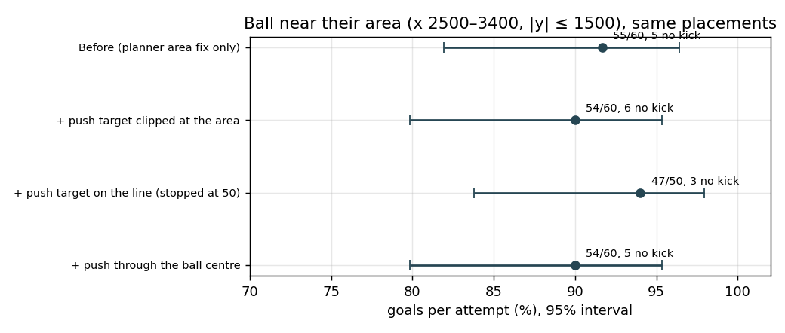

All four are inside each other's intervals. The failing attempts are also different
from run to run: the same placement fails about one time in ten. Each fix was based on
reading a few logged failures, and none addressed the general mechanism, which only
the first-touch data below made visible.

---

## 5. The first touch: what really causes the pushes

The keeper experiments record, for every attempt, where the ball sat on the robot's
front at the first contact, whether the kick was armed, and whether that contact was
the kick. 399 attempts (both keeper runs, clean data):

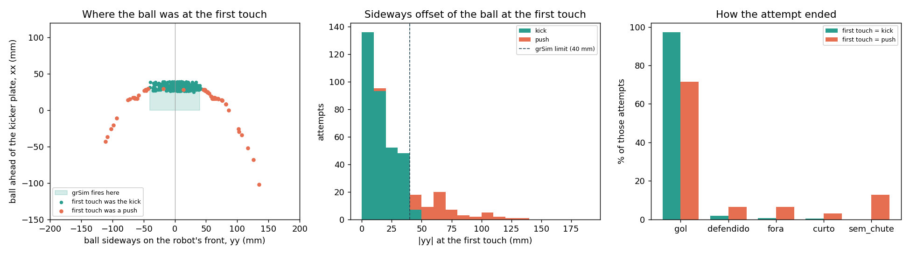

* **336 first touches were the kick.** The ball sat on the kicker: median 12 mm from
  its centre, p90 33 mm (grSim fires within 40 mm and 0–31.5 mm in front of the
  plate).
* **63 (16%) were pushes.** The ball touched the rounded front of the robot beside the
  kicker: median 63 mm from the centre, p90 103 mm. **The kick was armed in 57 of
  63.** The decision to kick is fine; the robot arrives sideways.
* **Cost.** After a push the kick takes a median 6.3 s instead of 2.7 s; most still
  end in a goal after a second approach. **All 8 no-kicks began with a push**, and in
  the keeper-on-the-line run all 23 attempts slower than 5 s did too.

Where this comes from in the code: the carrier may enter the push phase up to 90 mm
off the line of fire and stay in it up to 160 mm (`DESVIO_ENCAIXE`, `DESVIO_SOLTA` in
`skills/aproximacao.py`), while the kicker window is ±40 mm. Tightening those limits
is the obvious fix, but the code notes the robot's tracking error going round the ball
is 70 mm at p90, so a tight corridor could stop it from ever pushing. The fix has to
let the robot settle on the line first and then drive straight, and it should be
measured on this push rate.

---

## 6. Against a static keeper

### 6.1 Keeper on the goal line

200 attempts, `goleiro_linha/`, the strategy choosing its own aim, on the same
placements as the first 200 of the baseline.

| same 200 placements | goals | saved | wide | short | no kick |
|---|---|---|---|---|---|
| no keeper (baseline, forced aims) | 194 | – | 3 | 1 | 2 |
| keeper on the line | 185 | 6 | 3 | 1 | 5 |

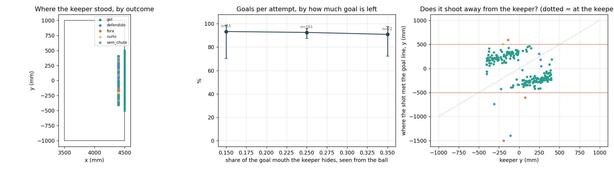

The right panel is the clearest result: **the shots form an X**. With the keeper on
one side, the ball goes to the other. Seen from the ball, a keeper on the line hides
only 15–35% of the goal mouth, and the goal rate barely depends on how much
(middle panel).

### 6.2 Keeper anywhere in the area

200 attempts, `goleiro_area/`, same placements again.

| same 200 placements | goals | stopped by the keeper | wide | short | no kick |
|---|---|---|---|---|---|
| no keeper | 194 | – | 3 | 1 | 2 |
| keeper on the line | 185 | 6 | 3 | 1 | 5 |
| keeper anywhere in the area | 188 | 4 | 3 | 2 | 3 |

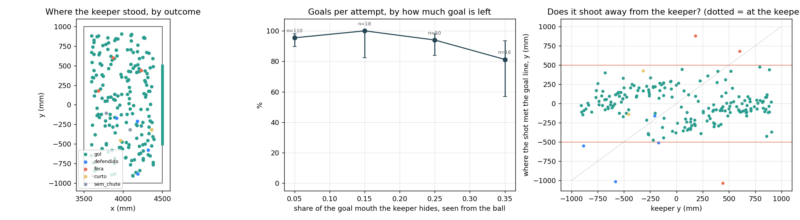

Placed anywhere in the area, the keeper usually hides *less* of the goal than on the
line: 20–40% of the mouth in 66 of 200 attempts, against 183 of 200 from the line. It
is often beside the mouth or far out to one side, where it covers little, and the
strategy keeps aiming at the open gap. So it stops fewer shots. Shots land a median 48 mm from the strategy's
aim (p90 163 mm).

**Caveat on "stopped".** The recorder counts a shot as stopped when the ball passes
within 200 mm of the keeper. A keeper standing beside the mouth can intercept a shot
that was already going wide: #141 (keeper at y = −884, shot heading for y = −548) and
#138 (keeper at −580, shot at −1014) are like that. The true number of saves in this
run is closer to 2.

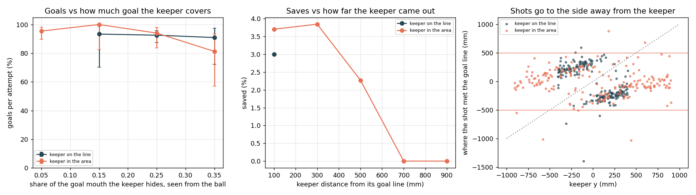

### 6.3 Why shots get saved

The strategy's goal rater (`skills/avaliacao_chute.melhor_alvo`) is pure geometry, so
its aim can be rebuilt offline from where the ball was kicked and where the keeper
stood. Against that aim, shots land a median **40 mm** away (p90 165 mm).

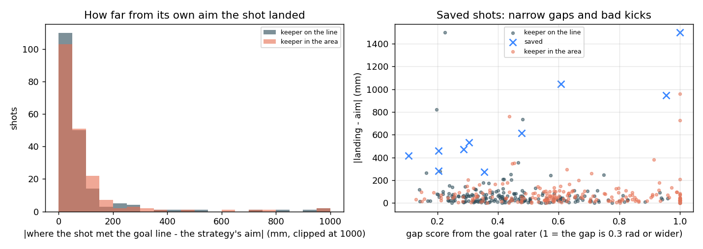

| save | gap score | aim y | landed y | keeper y |
|---|---|---|---|---|
| #56 | 0.20 | -315 | -35 | 38 |
| #95 | 0.29 | -286 | 184 | 263 |
| #132 | 0.10 | 463 | 47 | 272 |
| #198 | 0.30 | -226 | 306 | 245 |
| #17 | 0.96 | 210 | -738 | -311 |
| #115 | 1.00 | 278 | -1394 | -107 |

A gap score of 1 means an opening of 0.3 rad (17°) or more; 0.1–0.3 means 2–5°. Four
saves were shots into such narrow gaps that missed their aim by 280–470 mm, towards
the keeper. The 20° kick gate allows far more error than those gaps can take. The other
two had a wide-open goal and were bad kicks.

**Why some shots head for the centre.** Of 193 shots where the rater's aim and the
goal centre differ by more than 1.5°, 172 left closer to the aim and 21 closer to the
centre (including save #56). It is not the rater flipping between two equal gaps: only
one of the 21 (#82) had two gaps of the same width; most had one clearly wider gap, or
only one. In 14 of the 21 the *body* itself pointed nearer the centre, in about 8
of them on the other side of the keeper (aim −4.6° and body +4.9° in #65; aim −3.7°
and body +5.1° in save #95).

Against the strategy's aim, the body is a median 0.7° off at the kick (p90 2.0°), but
in **9 of 195 shots it was more than 4° off**, and the 20° gate lets those fire. With
the keeper near the middle, a 5–10° error is enough to send the ball to the centre or
the other side. The other shots of the 21 are small errors on aims only 2–3° from the
centre. **The fix is the same as for the saves: a kick gate based on the gap
(step 2).**

---

## 7. Time to kick

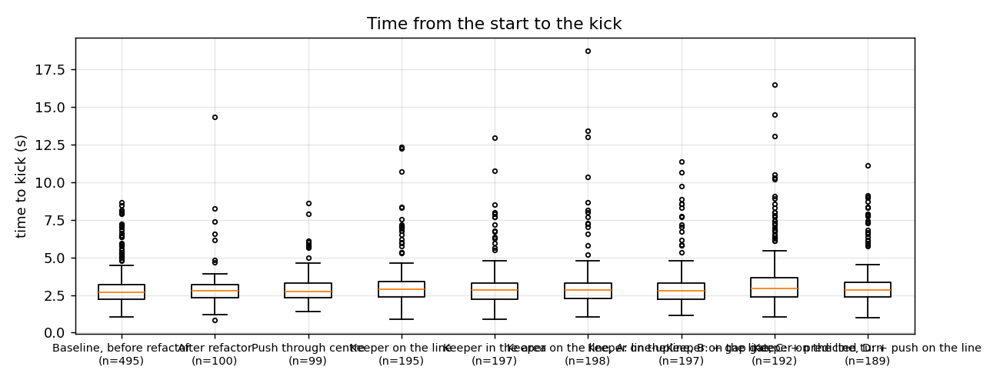

The median stays at 2.7–2.9 s in every experiment, keeper or not. The slow outliers are pushes: in
the keeper-on-the-line run **all 23 attempts slower than 5 s began with a push at the
first touch**. Fixing the first touch (section 5) is also what would remove them.

---

## 8. Data quality

* **Dead chain.** When the network changes, the referee's multicast stops reaching
  the stack and the robot never moves. Five such attempts in `goleiro_area/` had been
  recorded as no-kicks. The recorder now rejects any attempt where our robot moved less
  than 100 mm, and a scan of every other experiment found none.
* **A foreign game controller.** On the university network another machine
  (10.6.251.133) runs grSim and a game controller on the same multicast groups as ours.
  Its vision was already ignored; its referee commands were not, so our robots obeyed
  both controllers. The symptom was a block of very slow attempts (15 of 25 above 6 s
  in `goleiro_area/`, against about 1 in 25 in every other run). Those attempts were
  discarded and the run restarted with the referee filter on (section 9). All other
  experiments were either run on the home network or show no such pattern.
* **`area_na_linha/`** stopped at 50 of 60 when the network changed; that variant was
  dropped, so it was not completed.

---

## 9. Code changed during these experiments

| change | where | status |
|---|---|---|
| Penalty-area obstacle built from the real line coordinates, margin always outwards. It was 180 mm too narrow in y on both sides (\|y\| < 910 instead of 1090), so robots could stand inside the real area: a foul | `src/movement/.../penalty_area_obstacle.py` + tests | kept |
| Push and intercept targets clipped at a penalty area, along the line from the ball (`ARARABOTS_SEM_RECORTE_AREA=1` disables) | `roles/portador.py`, `campo.py` | kept |
| Push target on the line of fire | `roles/portador.py` | removed: no effect |
| Push aimed through the ball's centre | `roles/portador.py` | removed: more pushes |
| Referee packets from other machines ignored in simulation (`local_only`, on in `launch/sim_one.py`) | `src/referee/...` + tests | kept |
| Campaign: `--goleiro gol\|area`, `--miras auto`, `--tentativas`, `defendido` outcome, first-touch columns, dead-chain rejection, `CAMPANHA=<folder>` | `docs/campanha_chute.py`, `docs/ararabots.sh` | kept |
| Plots: keeper figure, path cut at the outcome, plots without forced aims | `docs/campanha_graficos.py` | kept |
| Cross-experiment analysis and figures | `docs/analise_campanhas.py` | new |
| Line-up rule: push only within 40 mm of the line of fire and near the ball (`ARARABOTS_SEM_CHEGADA_NA_LINHA=1` disables) | `roles/portador.py` | kept |
| Gap gate: kick at the goal only with the body inside the gap (`ARARABOTS_SEM_DISPARO_PELO_VAO=1` disables); the rater now returns the gap's edges | `analysis/alvo_chute.py`, `skills/avaliacao_chute.py`, `skills/chute.py` | kept |
| Predicted-turn gate (`ARARABOTS_DISPARO_PREVISTO=1` enables) | `skills/chute.py` | opt-in |

---

## 10. Steps 1–3: line-up rule, gap gate, predicted turn

Three changes, each measured on the **same 200 keeper-on-the-line placements** as
`goleiro_linha/`, added one at a time:

* **A, line-up rule** (`linha_so_chegada/`): the carrier starts the push only within
  40 mm of the line of fire and within about 450 mm of the ball, and leaves it beyond
  90 mm (before: 90 and 160 mm, from any distance). After 1.5 s near the ball without
  settling, it accepts the old 90 mm so it cannot stall.
  Switch: `ARARABOTS_SEM_CHEGADA_NA_LINHA=1`.
* **B, gap gate** (`linha_chegada_vao/`): a shot at the goal fires only with the body
  inside the gap it aims at, minus half a degree (never below 2°, never above the old
  20°). Switch: `ARARABOTS_SEM_DISPARO_PELO_VAO=1`.
* **C, predicted turn** (`linha_tudo/`): the gate also checks where the body will point
  100 ms later, using the turning rate from vision, because an armed kick stays armed
  until the next tick. Now **opt-in**: `ARARABOTS_DISPARO_PREVISTO=1`.

| same 200 placements | before | A: line-up | B: + gap gate | C: + predicted turn |
|---|---|---|---|---|
| goals | 185 | 186 | 187 | 186 |
| stopped by keeper | 6 | 3 | 5 | 1 |
| wide / short | 3 / 1 | 7 / 2 | 4 / 1 | 3 / 2 |
| no kick | 5 | 2 | 3 | 8 |
| first touch was a push | 34 (17%) | 27 (14%) | 24 (12%) | 48 (24%) |
| … of which the kick was not armed | 3 | 4 | 7 | 18 |
| kicks fired outside the gap | 11 | 16 | 6 | 4 |
| time to kick, median / p90 (s) | 2.9 / 5.8 | 2.8 / 4.0 | 2.8 / 4.1 | 2.9 / 7.0 |

**What it shows**
* **No change reached the goal rate** (185–187 of 200, inside the noise). Each improves
  part of the chain, and something else costs about the same.
* **A** helps where it was aimed: slower attempts and no-kicks fall, and pushes drop
  from 17% to 14%. The remaining pushes look like the old ones (ball 64 mm off the
  kicker's centre, kick armed): the robot starts the push on the line and still drifts
  sideways before contact. They happen more when the robot starts nearly behind the
  ball (18 of 100 attempts needing less than 90° of circling, 9 of 100 needing more).
* **B** does what it says on kicks: those fired outside the gap fall from 16 to 6. Saves
  did not fall (5 against 3 in A), so the narrow-gap saves are not only a gate problem.
* **C** almost stops saves (1), but disarms late in the approach, so the robot reaches the
  ball unarmed: pushes double, no-kicks rise to 8, slow attempts return. Net zero, so it
  is off by default. A shorter look-ahead may keep the save reduction without the pushes.

**Kept on by default:** A and B. They do not change goals but remove slow attempts and
off-gap kicks, which matter more against a moving keeper.

### 10.1 Where the sideways drift comes from

The remaining pushes were replayed with a new diagnostic line (`[JG] LINHA`: the
robot's, its velocity's and its target's offset from the line of fire, every tick),
and the movement tracker's reference was recorded next to the robot's real position
(`docs/gravar_referencia.py`).

* In the pushes the robot swings sideways at 200–380 mm/s in the last 250 mm while
  moving forward at about 250 mm/s, and meets the ball 60–100 mm off the line. In the
  clean kicks it stays within about ±20 mm.
* **The robot follows its plan:** at contact it is 2–13 mm from the tracker's reference.
* **The plan is what ends off the line:** in the pushes the reference was 23–70 mm to the
  side at contact; in most clean kicks within about 20 mm.
* The push target sits 20–45 mm to one side of the line: a fixed −27 mm offset
  (`VIES_LATERAL`, "the robot arrives offset by this much; the target compensates") plus
  the contour term.

**D, push target on the line** (`linha_na_linha/`): removes that sideways part, on top of
A and B. It made things worse. Without the disturbed block (below), on the same 175
placements: pushes 28 against 20 in B, goals 163 against 166, no-kicks 3 and 3. So the
−27 mm offset does compensate a real bias in the chain, and the pushes are the spread
around it (about ±50 mm), not a wrong compensation. Removed.

**Data note:** in run D, attempts 150–174 ran while another machine (10.6.60.155)
started broadcasting grSim vision. Our filters ignore it, but that block alone had 8 of
D's 11 no-kicks against 0 for B on the same placements, so it is excluded above.

**Where that leaves the pushes.** The kicker window (±40 mm) is narrower than the spread
of where the robot meets the ball (about ±50 mm around the compensated line), and
neither moving the target nor gating the push removes that spread. What is left:

1. **Precision of the movement chain at low speed**: why the same plan ends ±50 mm apart
   in the last 300 mm. This is in the movement package (planner replanning every tick
   on a short target, tracker and controller gains), and `gravar_referencia.py` is the tool
   to study it.
2. **Settle before pushing**: hold at the waiting point until the robot is on the line
   *and* nearly still sideways (pushes correlate with sideways speed when the push
   starts), at the cost of some time.
3. **Limit the damage**: near their area and the touch lines, where a push loses the ball,
   be stricter than in midfield, where a push only costs a second approach.

---

## 11. Reproducing

```bash
cd ssl-VICE/docs
./ararabots.sh preparar --headless                 # after a reboot or a network change

./ararabots.sh campanha 500                                          # baseline
CAMPANHA=goleiro_linha ./ararabots.sh campanha 200 --goleiro gol --miras auto
CAMPANHA=goleiro_area  ./ararabots.sh campanha 200 --goleiro area --miras auto
CAMPANHA=perto SEED=7  ./ararabots.sh campanha 60 --x-min 2500 --x-max 3400 --y-max 1500

python3 campanha_graficos.py <folder>      # plots and resumo.md of one experiment
python3 analise_campanhas.py               # the comparison figures in this report
```

Runs resume where they stopped. After a network change, run `./ararabots.sh parar`
and `./ararabots.sh preparar --headless` before continuing.
